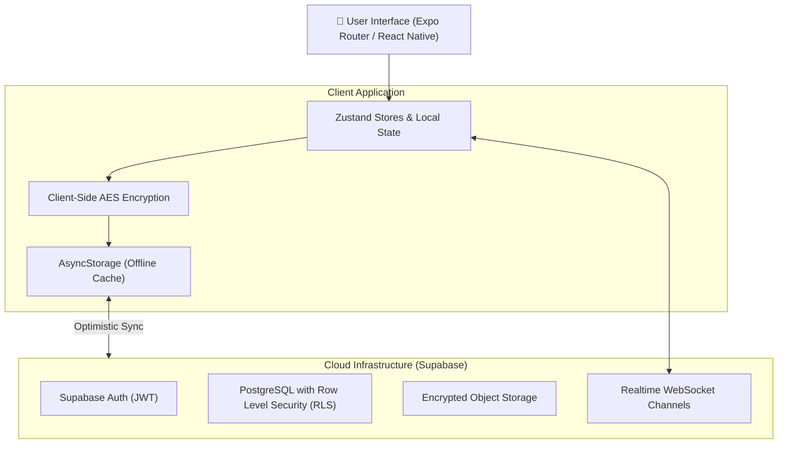

<div align="center">

# 📱 EvoRyz

### Build Better Days • Grow Together

*A modern personal growth, habit tracking, and social accountability platform for individuals, pairs, and teams.*

[](https://github.com/Scempyyy/EvoRyz/releases/tag/v1.0.0)
[](https://github.com/Scempyyy/EvoRyz)
[](https://expo.dev)
[](https://reactnative.dev)
[](https://www.typescriptlang.org)
[](https://supabase.com)

[⬇️ Download Android APK (v1.0.0)](https://github.com/Scempyyy/EvoRyz/releases/tag/v1.0.0) · [Report Bug](https://github.com/Scempyyy/EvoRyz/issues) · [Request Feature](https://github.com/Scempyyy/EvoRyz/issues)

</div>

---

## 📖 Overview

**EvoRyz** brings everyday planning and personal growth into one connected experience. Engineered with an offline-first architecture, it unifies daily schedules, structured habit routines, meals, encrypted reflective journaling, and real-time duo/team workspaces into a seamless experience.

---

## ⚡ Highlights & Core Capabilities

- 🏔️ **Winter Arc Engine**: 100-day structured discipline challenge with deterministic daily scoring algorithms, progress analytics, and streak tracking.
- 🤝 **Solo, Duo & Team Modes**: Partner accountability mode to share progress metrics, checklists, and real-time updates with friends or coaches.
- 🔐 **End-to-End Encrypted Journal**: Client-side AES encryption for private thoughts, daily reflections, and audio memos before syncing to the cloud.
- 📅 **EvoRyz Day Planner**: Integrated timeline blending habit blocks, to-dos, and structured meal logs into a single actionable schedule.
- 🤖 **EvoRyz AI Mentor**: Context-aware guidance assistant providing habit recommendations and personalized progress recaps.
- 📴 **Offline-First Synchronization**: Local persistence via AsyncStorage with optimistic mutation updates synced to Supabase PostgreSQL when connected.

---

## 🏗️ System Architecture



---

## 📁 Project Structure

```text
EvoRyz/
├── app/                         # Expo Router file-based screens and tabs
│   ├── (auth)/                  # Sign-in, sign-up, and onboarding flows
│   ├── (tabs)/                  # Daily planner, habits, journal, and profile
│   └── _layout.tsx              # Root navigation stack and theme provider
├── src/
│   ├── components/              # Modular UI components (cards, inputs, charts)
│   ├── services/                # Supabase client, encryption, AI mentor, sync
│   ├── store/                   # Central state management
│   ├── types/                   # TypeScript interfaces and data models
│   └── utils/                   # Scoring formulas, date helpers, UUID utils
├── supabase/
│   ├── migrations/              # SQL schema, RLS policies, and triggers
│   └── functions/               # Edge functions for serverless tasks
├── __tests__/                   # Comprehensive test suite (13 suites, 129 tests)
│   ├── encryption.test.ts       # Cryptographic cipher verification
│   ├── winterArcScoring.test.ts # Scoring engine and penalty calculations
│   ├── friends.test.ts          # Social graph and invite workflows
│   └── workspace.test.ts        # Duo/Team state management
├── app.json                     # Expo application configuration
└── package.json                 # Pinned dependencies and run scripts
```

---

## 🚀 Getting Started

### Prerequisites
- **Node.js**: `v20.x` or `v22.x`
- **npm** or **yarn**
- **Expo Go** or an Android/iOS emulator (or physical device)

### Quick Start

```bash
# 1. Clone the repository
git clone https://github.com/Scempyyy/EvoRyz.git
cd EvoRyz

# 2. Install dependencies
npm install

# 3. Configure environment variables
cp .env.example .env.local
# Edit .env.local with your Supabase URL and Anon Key

# 4. Start the Expo development server
npx expo start
```

Press `a` in the terminal to launch the Android emulator, or scan the QR code using the **Expo Go** app on your physical device.

---

## 🧪 Testing & Verification

The codebase includes test coverage across all business logic, encryption routines, and scoring systems:

```bash
# Run the Jest test suite
npm test

# Run TypeScript typecheck
npx tsc --noEmit
```

**Test Results:**
- ✅ **13 Test Suites Passed**
- ✅ **129 Tests Passed** (0 failures, 100% clean exit)

---

## 📦 Production Builds

A production APK release is pre-built and downloadable directly from GitHub:

- **Filename:** `EvoRyz-production.apk`
- **Size:** `107.97 MB`
- **Link:** [Download EvoRyz v1.0.0 Production APK](https://github.com/Scempyyy/EvoRyz/releases/tag/v1.0.0)

---

## 🤝 Contributing

Issues and thoughtful suggestions are welcome. Please describe the use case and expected behavior when reporting a problem or opening a PR.

---

## 👥 Contributors & Activity Graph

<div align="center">

[](https://github.com/Scempyyy/EvoRyz/graphs/contributors)
[](https://github.com/Scempyyy/EvoRyz/pulse)
[](https://github.com/Scempyyy/EvoRyz/commits/main)

<br/><br/>

<a href="https://github.com/Scempyyy/EvoRyz/graphs/contributors">
  
</a>

<br/><br/>

[📊 View Full Repository Insights & Contribution Graph →](https://github.com/Scempyyy/EvoRyz/graphs/contributors)

</div>

---

## 📄 License

This project is licensed under the [MIT License](LICENSE).
